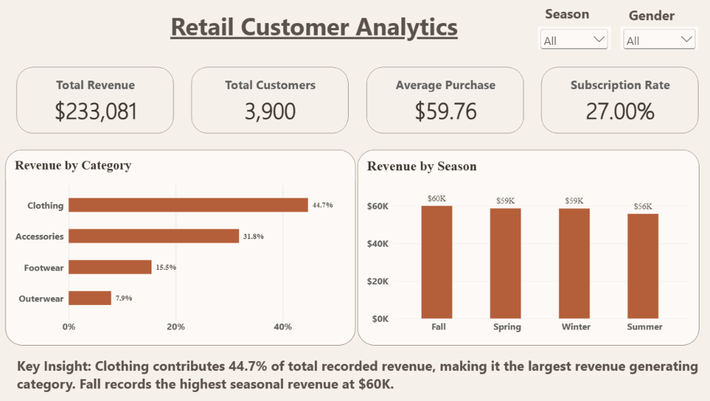
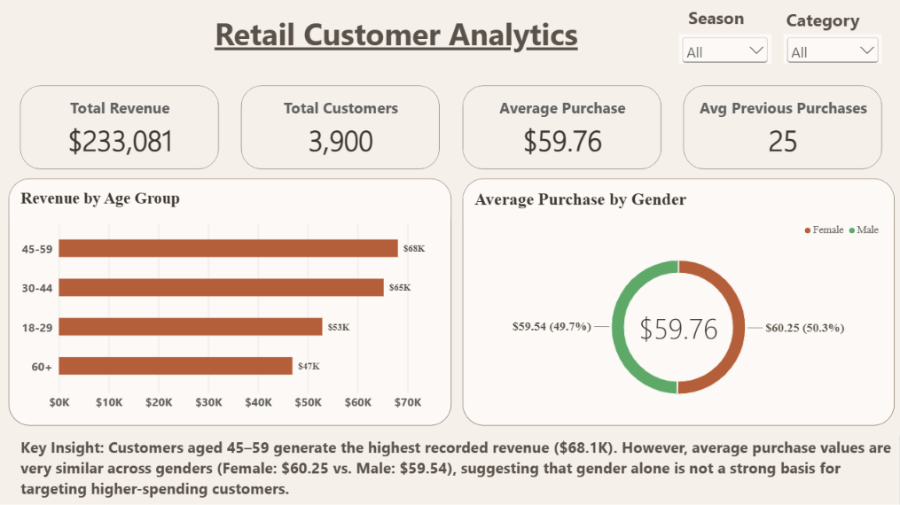
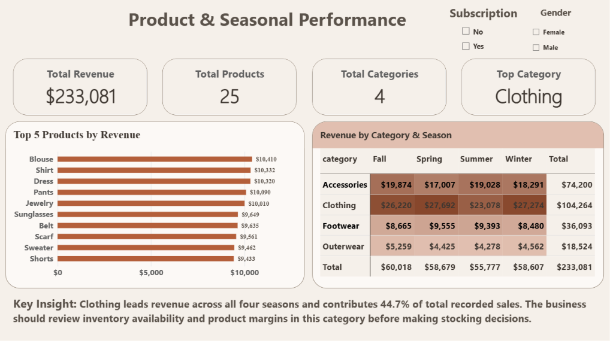
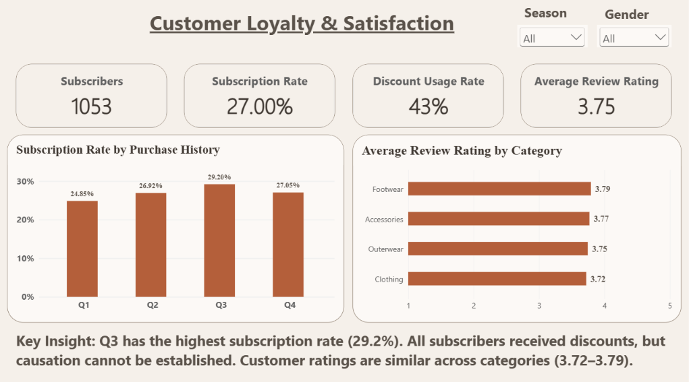

# Retail Customer Behavior Analysis

**From Python data preparation to a four-page Power BI dashboard and a business decision brief.**

By [Hamzah Al-Hakem](https://github.com/hamzah-ALhakem) · Python · pandas · Matplotlib · Power BI · DAX

This portfolio case study examines **3,900 synthetic customer purchase records** to understand revenue concentration, customer segments, product performance, and the overlap between subscriptions and discounts. It turns descriptive findings into specific business hypotheses, while keeping causal claims and data limitations explicit.

[Business analysis report](reports/Business_Analysis_Report.pdf) · [Analysis notebook](notebooks/customer_shopping_behavior_analysis.ipynb) · [Power BI setup](powerbi/README.md) · [Project audit](docs/AUDIT.md)



## The business question

Where should a retailer focus its next assortment, customer engagement, and promotional experiments?

The analysis asks which categories and products contribute the most recorded purchase value, whether segment differences reflect customer counts or spend per purchase, and whether subscription and discount patterns justify further investigation.

**Primary recommendation:** test promotions through randomized campaign assignment before expanding spending. Evaluate incremental contribution margin, conversion and repeat purchases using new transaction and cost data. The current sample cannot establish that discounts cause subscriptions or revenue growth.

## Verified snapshot

| Metric | Result | Definition |
|---|---:|---|
| Recorded purchase value | **$233,081** | Sum of recorded purchase amounts; not profit or audited company revenue |
| Unique customer records | **3,900** | Distinct customer IDs; one row per ID |
| Average recorded purchase | **$59.76** | Recorded purchase value / 3,900 records |
| Subscribers | **1,053 / 27.00%** | Subscription Status = Yes |
| Discount usage | **1,677 / 43.00%** | Discount Applied = Yes |
| Average observed review | **3.7501 / 5** | Mean of 3,863 nonmissing original ratings |
| Missing original ratings | **37 / 0.95%** | Preserved as missing; imputed values stored separately |

The original notebook's 43 nonempty code cells were rerun in order. The generated dataset matched the saved cleaned CSV and the PBIX's extracted table across **all 3,900 rows and 22 fields**. The portable notebook was also executed in a fresh Jupyter kernel. See [verification evidence](validation/verified_metrics.json) and the [audit](docs/AUDIT.md).

## Key findings and decisions

| Finding | What it means | Action to evaluate |
|---|---|---|
| Clothing contributes **$104,264 (44.73%)**. | It is the largest recorded revenue pool, not necessarily the most profitable category. | Examine product margins, returns and stock availability before reallocating inventory. |
| Ages **45-59** contribute **$68,066** across 1,142 records. | This is also the largest age group; its average purchase is $59.60. | Compare targeting experiments on incremental value and acquisition cost. |
| Female and male average purchases are **$60.25** and **$59.54**. | The $0.71 gap is small and has not been tested statistically. | Avoid treating total segment revenue as evidence of higher individual spend. |
| **Fall** contributes **$60,018**, the largest seasonal total. | Seasonal labels are cross-sectional; no dated time series is available. | Validate seasonal merchandising hypotheses against dated sales and inventory. |
| **Q3** has the highest subscription rate: **29.20%**. | Rates are not monotonic across purchase-history quartiles. | Investigate acquisition and subscription history before calling a segment loyal. |
| **All 1,053 subscribers used discounts.** | Subscription and discount exposure overlap; there is no subscriber-without-discount comparison. | Audit policy/data generation, then design an eligible randomized offer test. |

## Dashboard walkthrough

The four images are the **original supplied dashboard screenshots**, retained without alteration. They show the audited PBIX snapshot. The data-free source project contains documented improvements and has not been re-rendered in Power BI Desktop during this audit.

| Page | Focus |
|---|---|
| 01 · Executive Overview | Headline KPIs, category share and seasonal recorded revenue |
| 02 · Customer Insights | Age-group revenue and gender average purchase comparisons |
| 03 · Product & Seasonal Performance | Product ranking and category-by-season matrix |
| 04 · Customer Loyalty & Satisfaction | Subscription quartiles, discount usage and original ratings |

<details>
<summary>View the other three dashboard pages</summary>







</details>

**Audit corrections in the published Power BI source:** the product title now says Top 10 to match the configured ranking; gender averages use a bar chart; subscriber/discount measures preserve existing filters; the CSV path is parameterized; static commentary is labeled as a full-sample insight. Original screenshots still show the previous design. Details and remaining Desktop checks are in [the audit](docs/AUDIT.md).

## Methodology

1. Inspect the 3,900 × 18 raw file for duplicates, missing values, types and numeric ranges.
2. Preserve `review_rating`; flag missing values and create `review_rating_filled` using within-category medians.
3. Standardize column names and validate positive purchase amounts, unique customer IDs and rating bounds.
4. Add age bands (18-29, 30-44, 45-59, 60+) and previous-purchase quartiles (Q1-Q4).
5. Aggregate segment, category, product, season, rating, discount and subscription metrics.
6. Export 22 fields for Power BI and compare the notebook results with the dashboard's embedded data.

This project uses **Python and Power BI**. It does not claim SQL analysis, forecasting, machine learning, statistical significance, or measured business impact.

## Repository structure

```text
Retail-Customer-Behavior-Analysis/
├── README.md
├── requirements.txt
├── RIGHTS.md
├── notebooks/customer_shopping_behavior_analysis.ipynb
├── data/README.md                   # Source, access and reproduction notes
├── docs/
│   ├── AUDIT.md
│   └── DATA_DICTIONARY.md
├── powerbi/
│   ├── README.md
│   ├── Measures.dax
│   ├── Retail_Customer_Analytics.pbip
│   ├── Retail_Customer_Analytics.Report/
│   └── Retail_Customer_Analytics.SemanticModel/
├── reports/Business_Analysis_Report.pdf
├── screenshots/                     # Four original, clearly named images
└── validation/                      # Aggregate metrics and audit evidence
```

## Run the Python analysis

Use Python 3.13.9 for the tested environment. From the repository folder:

```bash
python -m venv .venv
```

Activate the environment:

```powershell
# Windows PowerShell
.venv\Scripts\Activate.ps1
```

```bash
# macOS / Linux
source .venv/bin/activate
```

Install dependencies and launch JupyterLab:

```bash
python -m pip install -r requirements.txt
python -m jupyter lab
```

Place an **authorized** copy of `customer_shopping_behavior.csv` in `data/raw/`, open the notebook and run all cells. It writes `data/processed/customer_shopping_cleaned.csv`. If using the upstream dataset, rename `shopping_trends_updated.csv` to the expected input name after reviewing its terms. Its ratings have no missing values, so missingness and rating statistics will differ from the audited project variant.

For an automated run:

```bash
python -m jupyter nbconvert --to notebook --execute notebooks/customer_shopping_behavior_analysis.ipynb --output executed_analysis.ipynb
```

Executed notebooks may contain row-level data: clear outputs before public redistribution.

## Open the Power BI source

1. Supply the authorized input and run the notebook to produce the cleaned CSV.
2. Open `powerbi/Retail_Customer_Analytics.pbip` in a current Power BI Desktop version supporting PBIP/PBIR.
3. In **Transform data → Manage parameters**, set `DataFilePath` to the full path of the cleaned CSV.
4. Refresh and verify the KPIs against the dataset version you supplied.

The public project includes report/model definitions but **no imported data cache**. Model serialization and report JSON validation are separate from Desktop rendering and live interaction tests; those Desktop tests were not completed in this audit. See [the setup guide](powerbi/README.md).

## Data provenance and publication boundary

The upstream source is Sourav Banerjee's [Customer Shopping Trends Dataset](https://www.kaggle.com/datasets/iamsouravbanerjee/customer-shopping-trends-dataset), described by its publisher as synthetic. A direct comparison with `shopping_trends_updated.csv` confirmed that all 17 non-rating columns and all observed ratings match the supplied project variant. The latter has 37 ratings missing.

On **2 November 2026**, Kaggle's metadata listed **“Other (specified in description)”**, and clear redistribution terms were not established. Therefore **raw/cleaned CSVs and the original PBIX, which embeds those rows, are intentionally excluded from the public repository**. No CC0 claim is made. The notebook's saved outputs are cleared. See [data access notes](data/README.md) and [rights](RIGHTS.md).

## Limitations

- Synthetic observations illustrate an analysis workflow; they do not establish real customer behavior or population-representative patterns.
- No transaction dates, costs, discount amounts, returns, campaign exposure or full transaction histories are available. Profit, growth, retention, churn, CLV and causal uplift cannot be calculated reliably.
- Each customer appears once. Previous purchases are a supplied count, not a longitudinal history.
- Q1-Q4 are purchase-history quartiles, not calendar quarters or validated loyalty segments.
- Ratings exclude missing original observations, whose absence may not be random.
- `discount_applied` and `promo_code_used` are identical in this sample. Their separate effects cannot be estimated.
- Frequency labels are retained as supplied; overlapping labels are not interpreted as distinct behavioral intervals.

## References

- [Dataset publisher](https://www.kaggle.com/datasets/iamsouravbanerjee/customer-shopping-trends-dataset)
- [Microsoft: Power BI Desktop projects](https://learn.microsoft.com/en-us/power-bi/developer/projects/projects-overview)
- [Microsoft: KEEPFILTERS](https://learn.microsoft.com/en-us/dax/keepfilters-function-dax)
